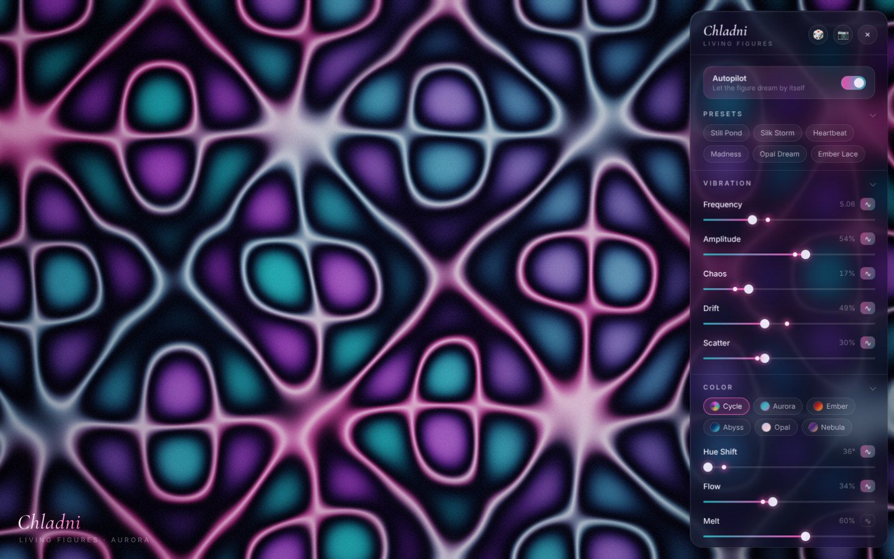

# Chladni — Living Figures

Chladni figures, the patterns sand draws on a vibrating plate, rendered as
living, melting light. The figure dreams by itself on autopilot, morphs as you
move the sliders, and can listen to music or your voice.



## Run it

It's a static site with no build step and no dependencies. ES modules have to
be served over http, so double-clicking `index.html` won't work:

```bash
npm run serve        # → http://localhost:5173
# or any static server, e.g. python3 -m http.server
```

To host it, push the repo to GitHub Pages (or any static host). The
microphone only works on `https://` or `localhost`.

## Play

| Control | What it does |
|---|---|
| **Frequency** | Which vibration mode the plate rings in; glides and morphs between modes |
| **Amplitude** | How hard the plate vibrates: brighter, sharper, breathing ribbons |
| **Chaos** | Blends in extra modes, from clean symmetry to organic tangles |
| **Drift** | How much the figure wanders and rotates by itself |
| **Scatter** | How soft and wide the glowing nodal lines are (and how loose the sand is) |
| **Hue Shift / Flow / Melt / Glow** | Color rotation, liquid domain warp, afterglow trails, bloom |
| **Palettes** | Aurora, Ember, Abyss, Opal, Nebula, or *Cycle* to let them melt into each other |
| **Sand** | Color field, color + sand, or sand only (~65k GPU particles; WebGL2) |
| **∿ buttons** | Route an LFO or a sound band onto any slider (max two sources per slider) |
| **Modulators** | Four LFOs (sine / triangle / wander), from 2-minute swells to 4 Hz wobbles |
| **Autopilot** | Pre-patched slow LFOs so the piece is alive with no input |
| **Sound** | 🎤 mic or 🎵 file (or drop audio anywhere): bass → amplitude & glow, beat → bloom flash, mid → chaos, treble → scatter, your pitch → frequency |

Keys: `H` hide panel · `F` fullscreen · `Space` pause time (sliders still respond) · `S` save PNG.
The panel fades away after a few idle seconds; move the pointer to bring it back.

## How it works

- `js/params.js`: parameter registry, frame-rate-independent easing (so nothing snaps)
- `js/modulators.js`: LFOs, routing matrix, autopilot and audio patches
- `js/palettes.js`: curated palettes, crossfades, hue rotation
- `js/audio-analysis.js` and `js/audio.js`: band energies, beat and pitch detection, auto-gain
- `js/field-math.js` and `js/shaders/`: the Chladni field `cos(nπx)cos(mπy) − cos(mπx)cos(nπy)`, domain warp, feedback, bloom, sand
- `js/renderer.js`: WebGL2 pipeline (WebGL1 fallback with 8-bit feedback and dithering, no sand)
- `js/quality.js`: adaptive render scale when frames run slow
- `js/ui.js` and `js/main.js`: the control panel and the frame loop

## Tests

```bash
npm test         # unit tests (node --test) for params, modulators, palettes, audio analysis, field math, quality
npm run e2e      # headless Chromium: WebGL2 + WebGL1, desktop + phone, sliders, sand, resize, PNG save, auto-hide
```

`node test/e2e/probe.mjs "" out.png '{"frequency":8}'` renders a screenshot
with slider overrides, which is handy for art direction.

Design spec: `docs/superpowers/specs/2026-10-24-chladni-art-design.md` ·
Plan: `docs/superpowers/plans/2026-10-24-chladni-art.md`
